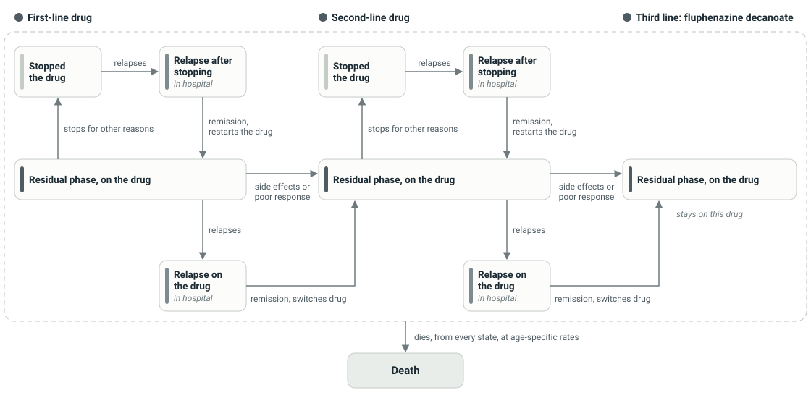

# Schizo-Model

Cost-effectiveness of five antipsychotics for schizophrenia in Uganda: chlorpromazine, haloperidol, quetiapine, risperidone and olanzapine.

This is the model behind:

> Lubinga SJ, Mutamba BB, Nganizi A, Babigumira JB. A cost-effectiveness analysis of antipsychotics for treatment of schizophrenia in Uganda. *Applied Health Economics and Health Policy*. 2015;13(5):493–506. [doi:10.1007/s40258-015-0176-3](https://doi.org/10.1007/s40258-015-0176-3)

**Live app:** https://theejonslo.shinyapps.io/schizo-model/

It is a 10-state Markov cohort model with 70 annual cycles. Outcomes are costs (2012 US$) and disability-adjusted life years (DALYs) per patient.

## Model structure



Each year people stay in their state (the loops) or move along one arrow. Everyone starts in the residual phase on their first-line drug. Side effects or lack of efficacy move people to the next drug, as does remission after a relapse on treatment; remission after a relapse off treatment restarts the same drug. The third-line drug is fluphenazine decanoate. The relapse states are spent in hospital.

## How the model calculates results

The model follows a cohort of patients aged $a_0$ = 25 for $T$ = 70 yearly cycles (cycle length $\tau$ = 1 year), so in cycle $t = 0, 1, \dots, T-1$ they are aged $a_t = a_0 + t\tau$. Each of the five drugs is the first-line drug $j_1$ of a treatment sequence. The second-line drug $j_2$ is risperidone after chlorpromazine or haloperidol, and haloperidol after quetiapine, risperidone or olanzapine. Fluphenazine decanoate (FLU) is the third line for everyone.

### States and transitions

| State | In `mtrace()` | Description |
|---|---|---|
| $\text{R}_1$, $\text{R}_2$, $\text{R}_3$ | 1, 2, 3 | Residual phase on the first-line drug, the second-line drug, or fluphenazine decanoate |
| $\text{S}_1$, $\text{S}_2$ | 4, 5 | Residual phase after stopping the first- or second-line drug (untreated) |
| $\text{A}'_1$, $\text{A}'_2$ | 6, 7 | Relapse after stopping the first- or second-line drug |
| $\text{A}_1$, $\text{A}_2$ | 8, 9 | Relapse while on the first- or second-line drug |
| $\text{D}$ | 10 | Dead |

Each year, a patient in the residual phase on drug $j$ relapses with probability $x^{\text{rel}}_j$, switches to the next drug because of side effects ($x^{\text{AE}}_j$) or lack of efficacy ($x^{\text{eff}}_j$), stops for other reasons ($x^{\text{oth}}_j$), or continues ($x^{\text{cont}}_j$). For each drug these five come from the same trial counts and add up to 1. Patients who have stopped treatment relapse with probability $x^{\text{rel}}_0$. Relapses are treated in hospital and remit with probability $\rho$: after a relapse off treatment the patient restarts the same drug, and after a relapse on treatment moves to the next one. Every living patient dies with probability $q_t$ in cycle $t$, whatever their state, and the rest stay where they are. For lines $\ell$ = 1 and 2:

$$P_t(\text{R}_\ell, \text{R}_{\ell+1}) = x^{\text{AE}}_{j_\ell} + x^{\text{eff}}_{j_\ell} \qquad P_t(\text{R}_\ell, \text{S}_\ell) = x^{\text{oth}}_{j_\ell} \qquad P_t(\text{R}_\ell, \text{A}_\ell) = x^{\text{rel}}_{j_\ell}$$

$$P_t(\text{S}_\ell, \text{A}'_\ell) = x^{\text{rel}}_0 \qquad P_t(\text{A}'_\ell, \text{R}_\ell) = \rho \qquad P_t(\text{A}_\ell, \text{R}_{\ell+1}) = \rho$$

$$P_t(s, \text{D}) = q_t \ \ (s \ne \text{D}) \qquad P_t(s, s) = 1 - \sum_{s' \ne s} P_t(s, s') \qquad P_t(\text{D}, \text{D}) = 1$$

So a patient stays on drug $j_\ell$ with probability $x^{\text{cont}}_{j_\ell} - q_t$, and stays on fluphenazine decanoate until death. Everyone starts in $\text{R}_1$, and the cohort trace $\pi_t$ (a row vector of the share of the cohort in each state) moves one cycle at a time:

$$\pi_0 = (1, 0, \dots, 0) \qquad \pi_{t+1} = \pi_t\, P_t$$

### Deaths

The WHO life table for Uganda gives ${}_5q_x$, the probability of dying within the 5-year age group that starts at age $x$, which is converted to a yearly probability. Deaths from schizophrenia, $q^{\text{SZ}}_x$ (WHO 2008 deaths by cause, in wider age groups), are used as yearly probabilities. A patient dies of one cause or the other, with each table read at the age group that contains $a_t$:

$$q^{\text{pop}}_x = 1 - (1 - {}_5q_x)^{1/5} \qquad q_t = q^{\text{pop}}_{a_t} + q^{\text{SZ}}_{a_t} - q^{\text{pop}}_{a_t}\, q^{\text{SZ}}_{a_t}$$

### Side effects

On drug $j$, the probability of extrapyramidal symptoms (EPS) comes from the odds ratio against placebo, and the probability of diabetes from the relative risk against haloperidol:

$$\text{EPS}_j = \frac{\text{OR}_j\, p_0}{1 - p_0 + \text{OR}_j\, p_0} \qquad \text{DM}_j = p_{\text{DM}}\, \text{RR}_j$$

### DALYs

Each year, the patients who died in the previous cycle lose the life expectancy $e(a_t)$ at their age (from the same life table), and the living accrue the disability weight $w_s$ of their state. Both are discounted at rate $r_{\text{O}}$:

$$\text{YLL}_t = q_{t-1}\, e(a_t) \sum_{s \ne \text{D}} \pi_{t-1,s} \ \ (\text{YLL}_0 = 0) \qquad \text{YLD}_t = \sum_s \pi_{t,s}\, w_s \qquad \text{DALYs} = \sum_{t=0}^{T-1} \frac{\text{YLL}_t + \text{YLD}_t}{(1 + r_{\text{O}})^{t}}$$

A state's disability weight is that of its phase (residual or acute) plus the expected disability from side effects: weight gain (with probability $p^{\text{wt}}_j$), EPS (for $\delta_{\text{EPS}}$ years) and diabetes. Patients who have stopped treatment have no side effects, and in hospital every patient is on chlorpromazine:

$$w_{\text{R}_\ell} = W_{\text{res}} + p^{\text{wt}}_{j_\ell} W_{\text{wt}} + \text{EPS}_{j_\ell}\, \delta_{\text{EPS}}\, W_{\text{EPS}} + \text{DM}_{j_\ell} W_{\text{DM}} \qquad w_{\text{R}_3} = W_{\text{res}} + p^{\text{wt}}_{\text{FLU}} W_{\text{wt}} + \text{EPS}_{\text{FLU}}\, \delta_{\text{EPS}}\, W_{\text{EPS}} + p_{\text{DM,FLU}} W_{\text{DM}}$$

$$w_{\text{S}_\ell} = W_{\text{res}} \qquad w_{\text{A}} = W_{\text{acute}} + p^{\text{wt}}_{\text{CPZ}} W_{\text{wt}} + \text{EPS}_{\text{CPZ}}\, \delta_{\text{EPS}}\, W_{\text{EPS}} + \text{DM}_{\text{CPZ}} W_{\text{DM}} \qquad w_{\text{D}} = 0$$

where $w_{\text{A}}$ is the weight of all four relapse states, and the disability from diabetes includes its complications:

$$W_{\text{DM}} = W_{\text{diab}} + p_{\text{neuro}} W_{\text{neuro}} + p_{\text{foot}} W_{\text{foot}} + p_{\text{imp}} W_{\text{imp}} + p_{\text{neph}} W_{\text{neph}}$$

Every living patient has the same probability of dying, so years of life lost are the same for all five drugs, and the drugs differ in DALYs only through disability.

### Costs

Each year a patient's cost depends on their state: $C^{\text{res}}_{j_\ell}$ in $\text{R}_\ell$, $C^{\text{res}}_{\text{FLU}}$ in $\text{R}_3$, $C^{\text{acute}}$ in the four relapse states, and nothing in the stopped states or once dead. Costs are discounted at rate $r_{\text{C}}$:

$$\text{Cost} = \sum_{t=0}^{T-1} \frac{1}{(1+r_{\text{C}})^{t}} \sum_{s} \pi_{t,s}\, C_s$$

**Staff pay.** Each staff member's hourly pay is their annual salary over the hours worked in a year, $h_k = S_k / H$, for psychiatrists (psy), psychiatric clinical officers (co), psychiatric nurses (nu) and pharmacy assistants (ph).

**A cycle in hospital** (the four relapse states; a stay of $L$ days on chlorpromazine). Ward rounds are counted per week, so they are divided by 7 for a daily cost. Laboratory tests (a blood count, syphilis and HIV) are done once per stay. A share $p^{\text{IP}}_{\text{carer}}$ of patients have a carer visit $v_{\text{carer}}$ times a week:

$$C^{\text{IP}}_{\text{staff}} = \left[\frac{1}{7}\left(R_{\text{maj}} \frac{d_{\text{maj}}}{60} \big(N^{\text{maj}}_{\text{psy}} h_{\text{psy}} + N^{\text{maj}}_{\text{co}} h_{\text{co}} + N^{\text{maj}}_{\text{nu}} h_{\text{nu}}\big) + R_{\text{min}} \frac{d_{\text{min}}}{60} \big(N^{\text{min}}_{\text{co}} h_{\text{co}} + N^{\text{min}}_{\text{nu}} h_{\text{nu}}\big)\right) + N_{\text{adm}} \frac{d_{\text{adm}}}{60} h_{\text{nu}}\right] \tau L$$

$$C^{\text{IP}}_{\text{lab}} = \frac{\text{CPI}_{2012}}{\text{CPI}_{2001}} \Big(c_{\text{FBC}} f_{\text{FBC}} + c_{\text{ESR}} f_{\text{ESR}} + p_{\text{TPHA}}\, c_{\text{TPHA}} f_{\text{TPHA}} + (1 - p_{\text{TPHA}})\, c_{\text{VDRL}} f_{\text{VDRL}} + c_{\text{HIV}} f_{\text{HIV}}\Big)$$

$$C^{\text{IP}}_{\text{capital}} = k_{\text{IP}}\, \tau L \qquad C^{\text{IP}}_{\text{travel}} = 2 c_{\text{trip}}\, p^{\text{IP}}_{\text{carer}} \frac{\tau L\, v_{\text{carer}}}{7} + 2 c_{\text{trip}} \qquad C^{\text{IP}}_{\text{work}} = \lambda (1 - u)\, \text{GDP}\, \tau$$

$$C^{\text{acute}} = L\, c_{\text{CPZ}} n_{\text{CPZ}} + \text{EPS}_{\text{CPZ}}\, L\, c_{\text{bz}} n_{\text{bz}} + \text{DM}_{\text{CPZ}}\, C_{\text{DM}} + C^{\text{IP}}_{\text{staff}} + C^{\text{IP}}_{\text{lab}} + C^{\text{IP}}_{\text{capital}} + C^{\text{IP}}_{\text{travel}} + C^{\text{IP}}_{\text{work}} + C_{\text{carer}}$$

**A cycle as an outpatient** ($V$ visits a month, so $12V\tau$ visits a cycle). The consultation is with a psychiatrist (a share $\sigma_{\text{psy}}$ of patients) or a clinical officer, and a nurse; then the drugs are dispensed. Blood counts are done once a cycle. A share $p^{\text{OP}}_{\text{carer}}$ of patients come to their visits with a carer:

$$C^{\text{OP}}_{\text{staff}} = \left[\frac{d_{\text{con}}}{60} \big(N_{\text{psy}}\, \sigma_{\text{psy}} h_{\text{psy}} + N_{\text{co}} (1 - \sigma_{\text{psy}}) h_{\text{co}} + N_{\text{nu}}\, \sigma_{\text{nu}} h_{\text{nu}}\big) + N_{\text{ph}} \frac{d_{\text{disp}}}{60} h_{\text{ph}}\right] 12 V \tau$$

$$C^{\text{OP}}_{\text{lab}} = \frac{\text{CPI}_{2012}}{\text{CPI}_{2001}} \big(c_{\text{FBC}} f_{\text{FBC}} + c_{\text{ESR}} f_{\text{ESR}}\big) \qquad C^{\text{OP}}_{\text{capital}} = k_{\text{OP}}\, 12 V \tau$$

$$C^{\text{OP}}_{\text{travel}} = 2 c_{\text{trip}} (p^{\text{OP}}_{\text{carer}} + 1)\, 12 V \tau \qquad C^{\text{OP}}_{\text{work}} = \lambda (1 - u) \frac{\text{GDP}}{264}\, 12 V \tau$$

On drug $j$ (tablets a day $n_j$ at price $c_j$; benzhexol for EPS for $\delta_{\text{EPS}}$ years), and on fluphenazine decanoate (injections a month):

$$C^{\text{res}}_j = 365\, c_j n_j + \text{EPS}_j\, 365\, c_{\text{bz}} n_{\text{bz}}\, \delta_{\text{EPS}} + \text{DM}_j\, C_{\text{DM}} + C^{\text{OP}}_{\text{staff}} + C^{\text{OP}}_{\text{lab}} + C^{\text{OP}}_{\text{capital}} + C^{\text{OP}}_{\text{travel}} + C^{\text{OP}}_{\text{work}} + C_{\text{carer}}$$

$$C^{\text{res}}_{\text{FLU}} = 12\, c_{\text{FLU}} n_{\text{FLU}} + \text{EPS}_{\text{FLU}}\, 365\, c_{\text{bz}} n_{\text{bz}}\, \delta_{\text{EPS}} + p_{\text{DM,FLU}}\, C_{\text{DM}} + C^{\text{OP}}_{\text{staff}} + C^{\text{OP}}_{\text{lab}} + C^{\text{OP}}_{\text{capital}} + C^{\text{OP}}_{\text{travel}} + C^{\text{OP}}_{\text{work}} + C_{\text{carer}}$$

**Carers** lose a share $\ell$ of their work time (264 work days a year), in hospital and as an outpatient: $C_{\text{carer}} = \lambda (1 - u)\, \text{GDP}\, \tau\, \ell\, \tfrac{264}{365}$. Time off treatment (the stopped states) costs nothing.

### Comparing the drugs

The drugs are compared on the efficiency frontier. A drug is dominated if another costs no more and incurs no more DALYs, and is better on one of the two. The rest are sorted by cost, and a drug is extendedly dominated, and dropped, if its ICER against the drug before it is higher than the ICER of the drug after it; this repeats until the ICERs rise along the frontier. Between neighbours on the frontier:

$$\text{ICER}_k = \frac{\text{Cost}_k - \text{Cost}_{k-1}}{\text{DALYs}_{k-1} - \text{DALYs}_k}$$

### Net benefit and the probability of cost-effectiveness

At a willingness to pay of WTP per DALY averted, a drug's net monetary benefit counts its DALYs as a loss. In the probabilistic analysis, a drug's probability of being cost-effective is the share of the $N$ draws in which it has the highest net benefit (the acceptability curve plots this against WTP):

$$\text{NMB}_j = -\text{WTP} \times \text{DALYs}_j - \text{Cost}_j \qquad P_j(\text{WTP}) = \frac{1}{N} \sum_{n=1}^{N} \mathbf{1}\Big[\text{NMB}^{(n)}_j = \max_i \text{NMB}^{(n)}_i\Big]$$

The one-way analysis compares a drug $I$ with a comparator $K$: the incremental cost $\Delta C = \text{Cost}_I - \text{Cost}_K$, the DALYs averted $\Delta E = \text{DALYs}_K - \text{DALYs}_I$, the ICER $\Delta C / \Delta E$, or the incremental net benefit $\text{WTP} \times \Delta E - \Delta C$. The ICER is shown only when $I$ costs more and averts more; otherwise the run is labelled dominant ($\Delta C \le 0$ and $\Delta E \ge 0$), dominated ($\Delta C \ge 0$ and $\Delta E \le 0$), or cheaper and less effective.

### Sensitivity analyses

In the one-way analysis each parameter is set to its low and its high value. Each transition probability $x_i$ is set to the 2.5% and 97.5% points of its own distribution, $\text{Beta}(\alpha_i, \sum_k \alpha_k - \alpha_i)$, where $\alpha$ are the trial counts of that drug's set, and the others in the set are rescaled so it still adds up to 1: $x_k' = x_k\, (1 - x_i') / (1 - x_i)$.

In the probabilistic analysis, probabilities, proportions and disability weights are drawn from beta distributions; the odds ratios for EPS and relative risks for diabetes from log-normal distributions, with a log-scale standard deviation of $(\ln \text{high} - \ln \text{low}) / 3.92$; costs and prices, staff times, salaries and working hours, GDP per capita, the length of stay, visit frequencies and the carers' lost work time from normal distributions; and each drug's five transition probabilities from a Dirichlet distribution with its trial counts $\alpha$. The age, cycle length, discount rates, EPS duration, ward-round schedule, staff numbers, doses and test frequencies are fixed.

| Symbol | Input in `data_input.xlsx` | Base case |
|---|---|---|
| $a_0$; $T$; $\tau$; $r_{\text{C}}$, $r_{\text{O}}$ | `age`; `nCycles` in `R/data_input.R`; `time`; `discCosts`, `discOutcomes` | 25 years; 70 cycles; 1 year; 3%, 3% |
| $x^{\text{rel}}_j, x^{\text{AE}}_j, x^{\text{eff}}_j, x^{\text{oth}}_j, x^{\text{cont}}_j$ | `pHosp…`, `disAE…`, `disEff…`, `disOther…`, `rem…` for each drug (Transition Probabilities sheet, with the trial counts $\alpha$ in `alpha`) | risperidone, for example: 0.102, 0.069, 0.192, 0.214, 0.423 |
| $x^{\text{rel}}_0$; $\rho$ | `pHospUntrt`; `pRemitCPZ` | 0.733; 0.788 |
| ${}_5q_x$; $q^{\text{SZ}}_x$; $e(x)$ | Uganda Life Tables, Schizo Death Probability and Life Expectancy sheets | at age 25: 0.034, 0.0024, 39.1 years |
| $p_0$; $p_{\text{DM}}$, $p_{\text{DM,FLU}}$; $\text{OR}_j$, $\text{RR}_j$ | `pEPSPLA`; `pDiabetesHAL`, `pDiabetesFLU`; `eps…`, `diab…` for each drug | 0.064; 0.052, 0.06; Table 2 of the paper |
| $W_{\text{res}}$, $W_{\text{acute}}$; $W_{\text{wt}}$, $p^{\text{wt}}_j$; $W_{\text{EPS}}$, $\delta_{\text{EPS}}$ | `residualDALY`, `acuteDALY`; `disutilWeight`, `pWt…`; `disutilEPS`, `durEPS` | 0.576, 0.756; 0.031, by drug; 0.074, 0.25 years |
| $W_{\text{diab}}$; $p_{\text{neuro}}, p_{\text{foot}}, p_{\text{imp}}, p_{\text{neph}}$; $W_{\text{neuro}}, W_{\text{foot}}, W_{\text{imp}}, W_{\text{neph}}$ | `dDiabetes`; `pNeuro`, `pFoot`, `pImpotent`, `pNephro`; `dNeuro`, `dFoot`, `dImpotent`, `dNephro` | 0.015; 0.464, 0.040, 0.103, 0.048; 0.099, 0.023, 0.019, 0.105 |
| WTP | set in the app; the acceptability curves run from 0 to a maximum you choose | $1,641 (three times Uganda's 2012 GDP per capita) |
| $S_{\text{psy}}, S_{\text{co}}, S_{\text{nu}}, S_{\text{ph}}$; $H$ | `rate_psy`, `rate_pco`, `rate_pno`, `rate_pharm`; `workhours_year` | $5,049, $1,261, $970, $1,087; 2,000 hours |
| $R_{\text{maj}}, R_{\text{min}}$; $d_{\text{maj}}, d_{\text{min}}$ | `major_week`, `minor_week`; `duration_major`, `duration_minor` | 1 and 2 rounds a week; 20 minutes each |
| $N^{\text{maj}}_{\text{psy}}, N^{\text{maj}}_{\text{co}}, N^{\text{maj}}_{\text{nu}}$; $N^{\text{min}}_{\text{co}}, N^{\text{min}}_{\text{nu}}$ | `PSY_major`, `PCO_major`, `PNO_major`; `PCO_minor`, `PNO_minor` | 1, 1, 2; 1, 2 |
| $N_{\text{adm}}$, $d_{\text{adm}}$ | `PNO_drugadmin`, `duration_drugadmin` | 1 nurse, 20 minutes a day |
| $N_{\text{psy}}, N_{\text{co}}, N_{\text{nu}}, N_{\text{ph}}$; $\sigma_{\text{psy}}, \sigma_{\text{nu}}$ | `PSY`, `PCO`, `nurse`, `pharm`; `PSY_prop`, `nurse_prop` | 1 each; 0.25, 1 |
| $d_{\text{con}}$, $d_{\text{disp}}$; $V$ | `duration_consult`, `duration_drugdisp`; `visitation_frequency` | 20 and 10 minutes; 1 visit a month |
| $L$ | `LOS` | 60 days |
| $c$ and $f$ for each test; $p_{\text{TPHA}}$ | `FBC_cost`, `FBC_freq`, … `HIV_cost`, `HIV_freq`; `TPHA_proportion` | each test once (a stay in hospital, a cycle as an outpatient); 0.1 |
| $k_{\text{IP}}$, $k_{\text{OP}}$ | `capital_costs_per_inpatient_per_day`, `capital_costs_per_outpatient_visit` | $8.46 a day, $2.49 a visit |
| $c_{\text{trip}}$; $p^{\text{IP}}_{\text{carer}}$, $v_{\text{carer}}$; $p^{\text{OP}}_{\text{carer}}$ | `averagetravel_cost`; `caregiver_prop` (hospital patients visited by a carer), `caregiver_freq` (visits per `every` = 7 days); `caregiver_visit` (outpatients who come with a carer) | $2 each way; 0.4, 1 visit a week; 0.3 |
| $\lambda$, $u$, GDP; $\ell$ | `laborforcerate`, `unemploymentrate`, `GDP_percapita`; `DALY_caretaker` | 0.706, 0.052, $547; 0.25 |
| $C_{\text{DM}}$; $c_j$, $n_j$ | `cDiabetes`; `…_cost`, `…_qty` for each drug | $627 a year; Table 2 of the paper |
| $c_{\text{bz}}$, $n_{\text{bz}}$ | `artane_cost`, `artane_qty` | $0.016, 1 a day |

`mtrace()` and `RunModel()` in `R/functions.R` build the transitions, deaths, DALYs and costs; `state_weight()`, `third_line_weight()`, `ip_costs()`, `op_costs()`, `residual_cost()`, `acute_cost()` and `third_line_cost()` follow the equations for the weights and costs term by term. `IncrementalAnalysis()` finds the frontier, `genProbCE()` and `owsaPair()` work out net benefits, and `getTPbounds()`, `owsa()` and `draw_psa_df()` run the sensitivity analyses.

## Contents

| Path | What it is |
|---|---|
| `new_model_10_21_15.xlsm` | The original Excel model (2015) |
| `data/data_input.xlsx` | All inputs: parameters, transition probabilities, CPI, life tables |
| `R/functions.R` | Model, cost-effectiveness frontier, one-way and probabilistic sensitivity analyses |
| `R/data_input.R` | Reads the inputs and model settings into one list |
| `R/00_packages.R` | Loads the packages the model uses |
| `main.R` | Runs the base case, one-way analysis (tornado), PSA and acceptability curves |
| `app.R`, `app/`, `www/` | The interactive Shiny app: page layout and server (`app.R`), helpers, charts and input editors (`app/`), styles, font, icon and the model structure figure (`www/`) |

## Changes since the 2015 publication

The published results came from the Excel model, which is kept in this repository unchanged. The R version reproduces its structure, with the corrections below, so its results differ from the paper.

| Change | Excel model (2015) | R model | Effect on base-case costs |
|---|---|---|---|
| **Cost of acute (hospitalised) states** | The four acute-state cost cells multiplied by the YLD columns (state occupancy × disability weight) instead of the state occupancy, so hospital costs were scaled down by the disability weight (about 0.77) | Costs are multiplied by state occupancy | About +$310 to +$415 per patient |
| **Laboratory-cost inflation** | Lab costs were inflated with a mistyped 2012 CPI (196.64 instead of 196.46) | All CPI adjustments are read from the CPI sheet of `data_input.xlsx` | About −$0.09 per patient |
| **HIV test in inpatient lab costs** | The HIV-test frequency multiplied the VDRL term, so the HIV test was never costed | HIV test cost × frequency is added as its own term | About +$5 to +$7 per patient |
| **Drug price years** | Chlorpromazine and haloperidol prices (MSH International Drug Price Indicator Guide 2013, already in US$) were inflated with an index of 145.14, which is not in the CPI table; inpatient chlorpromazine was inflated from 2010 instead. Benzhexol (Artane), already converted to 2012 US$ from its NMS October 2010 price, was inflated a second time with 196.46/145.14 | MSH prices are used as published, like olanzapine and risperidone. Benzhexol is converted once: 15,750 UGX per 500 tablets, at 2,577 UGX/$, inflated from 2010 | −$6 to −$17 |
| **Haloperidol dose** | One 10 mg tablet a day at $0.0206 | Two 5 mg tablets a day at $0.022, as in Table 2 of the paper | +$9 to +$12 (haloperidol, and the three drugs that use it second line) |
| **Quetiapine price** | $0.388 per 200 mg tablet | $0.188, the pharmacy-survey price in Table 2 of the paper. The source of $0.388 could not be traced | −$276 (quetiapine only) |
| **Benzhexol in residual states** (bug) | Outpatients with extrapyramidal symptoms (EPS) were costed for the 60-day inpatient supply of benzhexol. The cell for an outpatient supply was never used | Costed for the duration of EPS (`durEPS`, 0.25 years), the duration used for the disability from EPS | +$0.4 to +$0.5 |
| **Background mortality** (bug) | The WHO life table for Uganda gives the probability of dying within each 5-year age group (₅qₓ). These were used as yearly probabilities, so people died about five times too fast: life expectancy from age 25 was 16.7 years, against 39 years in the same life table | The 5-year probabilities are converted to yearly ones, 1 − (1 − ₅qₓ)^(1/5), using the width of each age group. Life expectancy from age 25 is now 33.3 years, including the extra mortality from schizophrenia | +$2,619 to +$2,657; DALYs −5.54 to −5.55 |
| **Staff time** (bug) | Ward rounds are counted per week, but only the psychiatrist's major round was divided by 7 to give a daily cost, and the daily drug round was added in hours rather than dollars. In outpatient care, the consultation length applied to the psychiatrist only, so the clinical officer and nurse were costed for a full hour | Every weekly round is divided by 7, the drug round is costed at the nurse's hourly pay, and the consultation length applies to everyone at it (equations above). Staff time per hospital stay falls from $123.25 to $30.63, and per year of outpatient care from $15.11 to $7.44 | −$257 to −$292 |
| **Laboratory tests** (bug) | Tests were costed 12 times a cycle, as if done every month of the year: blood counts for outpatients, and blood counts, syphilis and HIV tests for each hospital stay | As the paper's methods describe: a blood count once a cycle, and the hospital tests once per stay (equations above). Lab costs per hospital stay fall from $117.28 to $9.77, and per year of outpatient care from $60.73 to $5.06 | −$1,124 to −$1,136 |
| **Carers at outpatient visits** | Carers' travel to outpatient visits used the share of hospital patients visited by a carer (0.4). The share of outpatients who come to clinic with a carer (0.3) was in the inputs but never used | Uses the share of outpatients who come with a carer (`caregiver_visit`). Carer travel per year of outpatient care falls from $19.20 to $14.40 | −$82 to −$85 |
| **Probability of cost-effectiveness** (bug) | Net benefit was computed as WTP × DALYs − cost, with DALYs incurred, so more DALYs counted as a benefit (the PSA sheet, and the net-benefit equation in the paper). The acceptability curve and the published shares (risperidone most cost-effective in 85% of simulations at $547 and 74% at $1,641) used this | DALYs count as a loss: net benefit = −WTP × DALYs − cost | None on the base case; changes the acceptability curve |

Changes interact, so their effects don't add up exactly to the difference between the two models. Inpatient drug costs follow the length of stay, as in the Excel model; this matters only in the sensitivity analyses. Table 2 of the paper gives the staff at ward rounds the wrong way round (2 clinical officers and 1 nurse); the model's counts, 1 clinical officer and 2 nurses at each round, are the correct ones. The R model runs 70 yearly cycles (to age 94), the Excel model 62 (to age 86); with the corrected mortality about 2% of the cohort is still alive at 86, so this adds about $4 and 0.02 DALYs per patient. The fluphenazine decanoate price ($1.406 per 25 mg ampoule, from the NMS October 2010 catalogue) is kept as published, although it cannot be reproduced from the catalogue price of 3,950 UGX per ampoule at 2,577 UGX/$. The schizophrenia-related death probabilities (WHO 2008 deaths by cause, in wider age bands) are used as yearly probabilities, as before.

Base-case results per patient (costs in 2012 US$):

| Drug | Cost, Excel model (2015) | Cost, R model | DALYs, Excel model | DALYs, R model |
|---|---|---|---|---|
| Chlorpromazine | $4,617 | $6,231 | 27.608 | 22.066 |
| Haloperidol | $4,440 | $5,984 | 27.563 | 22.012 |
| Quetiapine | $4,943 | $6,229 | 27.562 | 22.009 |
| Risperidone | $4,424 | $5,969 | 27.557 | 22.008 |
| Olanzapine | $4,454 | $5,980 | 27.552 | 22.003 |

In the Excel model, olanzapine cost $5,868 per DALY averted compared with risperidone. In the R model, chlorpromazine, haloperidol and quetiapine are dominated. Risperidone costs the least; olanzapine costs $10.36 more per patient and averts 0.005 DALYs, or $2,115 per DALY averted. That is above three times Uganda's 2012 GDP per capita ($1,641), so risperidone is the cost-effective choice at that threshold. The differences are small, though: in the probabilistic analysis (1,000 draws), risperidone is the most cost-effective drug in about 55% of draws at $1,641 per DALY averted, and olanzapine in about 45%.

## Running it

Install the packages listed at the top of `R/00_packages.R`, then open `Schizo-Model.Rproj` in RStudio and run `main.R`.

The model functions take everything they need as arguments:

```r
inputs <- read_inputs()   # input tables, plus nStates, nCycles and interventions
base_case <- RunModel(inputs,
                      baseparms = getparms(inputs$parameters, value = basecase),
                      basetransitions = getparms(inputs$transitions, value = basecase))
psa_res <- RunPSA(base_case, nsims = 1000)
```

The result of `RunModel()` carries its inputs, so `owsa()` and `RunPSA()` only need the model object.

## The app

The Shiny app runs the same model. You can:

- edit any input: parameters and their distributions, transition probabilities, mortality and life-expectancy tables, the price index, the time horizon and the willingness-to-pay threshold, then download your inputs as a spreadsheet and upload them again later;
- see the base case, with the efficiency frontier on a cost-effectiveness plane;
- run the one-way analysis for any pair of drugs, as a tornado diagram of the incremental cost, DALYs averted, cost per DALY averted or net monetary benefit;
- run the probabilistic analysis, with acceptability curves for all five drugs and a cost-effectiveness plane for each drug against a comparator;
- read how this version differs from the published model.

To run it locally, install the packages the model uses (listed in `R/00_packages.R`) plus the app's own:

```r
install.packages(c("shiny", "bslib", "reactable", "writexl"))
shiny::runApp()
```

Shiny loads the files in `R/` automatically before `app.R`. To deploy it to shinyapps.io from this folder:

```r
rsconnect::deployApp(appName = "schizo-model")
```

`.rscignore` leaves the Excel model out of the deployed bundle. The app uses the Atkinson Hyperlegible Next and Mono fonts (SIL Open Font License, `www/fonts/OFL.txt`), bundled so they work offline.

## Licence

The code is released under the MIT License (see `LICENSE`). The bundled fonts are under the SIL Open Font License (see `www/fonts/OFL.txt`). The published article is not covered by this licence.
